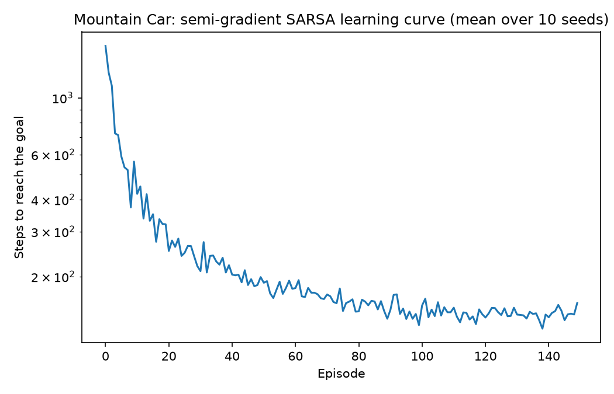
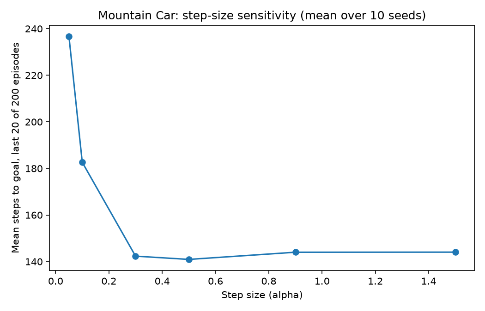

# function-approx-rl

Linear function approximation with tile coding, applied to semi-gradient
SARSA on Mountain Car — the classic example of a control problem a tabular
method cannot represent, because position and velocity are continuous.

This is the layer above [tabular-control-rl](https://github.com/ZahraAliAlharz/tabular-control-rl)
in the same stack: same TD control idea (SARSA), same `epsilon`/`alpha`
mechanics, but now the state space can't be stored in a dict keyed by
discrete states at all — it has to be approximated. It's also the specific
next step [social-dilemma-rl](https://github.com/ZahraAliAlharz/social-dilemma-rl)'s
README names directly: *"replace tabular Q-learning with a small neural
Q-network so the grid can scale past what a hashable ... view can
represent."* Tile coding is the linear predecessor to that — the same
scaling problem, solved without a neural network first.

## Install

```bash
pip install -e ".[dev]"
pytest -q
```

## The problem: Mountain Car

A car sits in a valley between two hills. Its engine is deliberately too
weak to drive straight up the far hill — the only way to reach the goal is
to reverse up the near hill first to build momentum, then accelerate
forward. Reward is −1 per time step until the goal is reached, so the
agent is learning to minimize time-to-goal, with no direct signal telling
it that reversing is ever a good idea — it has to discover that from
experience, which is what makes this a non-trivial exploration-free
control problem even at `epsilon=0`.

## Method

- **Tile coding** (`TileCoder`) — overlays `num_tilings` grids on the
  (position, velocity) space, each offset from the others by a fraction
  of a tile width. A state activates exactly one tile per tiling, giving a
  sparse binary feature vector that generalizes locally: nearby states
  share most active tiles, distant states share none.
- **Semi-gradient SARSA** (`SemiGradientSarsa`) — `Q(s, a)` is a linear
  function of the active tiles' weights for action `a`. Because the
  features are binary, the usual semi-gradient TD update reduces to:
  nudge the active tiles' weights for the action taken toward the TD
  target, leave every other weight untouched.

## Results

### 1. The agent learns to pump momentum: steps-to-goal drops ~7.6x

150 episodes, 10 seeds, 8 tilings × 8×8 tiles, alpha=0.3, epsilon=0 (no
exploration needed — the TD bootstrapping itself drives early behavior
change within the very first long episode):



| | Mean steps to reach the goal |
|---|---|
| First 5 episodes | 1081 |
| Last 20 episodes | 142 |

Early episodes start near the per-episode step cap, because an
all-zero-weight initialization makes every action look equally good, so
the (tie-broken) policy does not yet know to reverse first. Within a
handful of episodes, the agent discovers the back-and-forth momentum
strategy and steps-to-goal drops sharply — plotted on a log scale, since
the gap is nearly an order of magnitude.

### 2. Step size: clear improvement up to a point, then a plateau — not the instability I expected to find



| alpha | Mean steps to goal, last 20 of 150 episodes |
|---|---|
| 0.05 | 236.8 |
| 0.1 | 182.6 |
| 0.3 | 142.3 |
| 0.5 | 140.9 |
| 0.9 | 144.0 |
| 1.5 | 144.1 |

I expected to reproduce the full U-shape of Sutton & Barto (2018), Figure
10.2 — better with more alpha, then *worse* past some point from
overshooting. What I actually got is the first half of that shape: a
real, substantial improvement from alpha=0.05 to alpha=0.3-0.5, then an
essentially flat plateau out to alpha=1.5, no measurable degradation.
The likely reason is that `alpha` here is divided internally by
`num_tilings` (8) before being applied per tile — a nominal alpha=1.5 is
actually a per-tile step of about 0.19, nowhere near large enough on this
8×8 tiling resolution to make one update overshoot and destabilize
nearby tiles' generalization. Reporting the plateau I actually measured,
not the instability I went in expecting to find.

## Repository layout

```
src/function_approx_rl/
  envs/mountain_car.py         # MountainCar: position/velocity dynamics, reward, termination
  agents/tile_coding.py         # TileCoder: sparse binary features from overlapping tilings
  agents/semi_gradient_sarsa.py # SemiGradientSarsa: linear Q(s,a), semi-gradient TD update
  metrics.py                     # episode/training loops
  train.py                       # single-run CLI
experiments/
  sweep_mountain_car.py          # generates both results/*.png figures
tests/                            # pytest suite for the env, tile coder, and agent
```

## Usage

```bash
# Single run from the CLI
python -m function_approx_rl.train --episodes 150 --alpha 0.3

# Full experiment that regenerates the figures above
python experiments/sweep_mountain_car.py
```

## What I'd do next

- Swap tile coding for a small neural network (the exact next step
  `social-dilemma-rl`'s README already names) and compare sample
  efficiency directly against this linear baseline on the same problem.
- Add eligibility traces (true online SARSA(lambda)) and show it reaches
  the same converged performance in fewer episodes than one-step
  semi-gradient SARSA.
- Try asymmetric tile offsets (Sutton & Barto's displacement-vector
  construction) instead of this implementation's uniform fractional
  offset, and check whether it meaningfully changes the step-size
  sensitivity curve above.

## References

- Sutton, R. S., & Barto, A. G. (2018). *Reinforcement Learning: An
  Introduction* (2nd ed.), Chapter 9 (tile coding) and Chapter 10
  (semi-gradient control, Mountain Car).
- Moore, A. W. (1990). *Efficient Memory-based Learning for Robot
  Control*. PhD thesis, University of Cambridge — original Mountain Car
  formulation.

## License

MIT — see [LICENSE](LICENSE).
